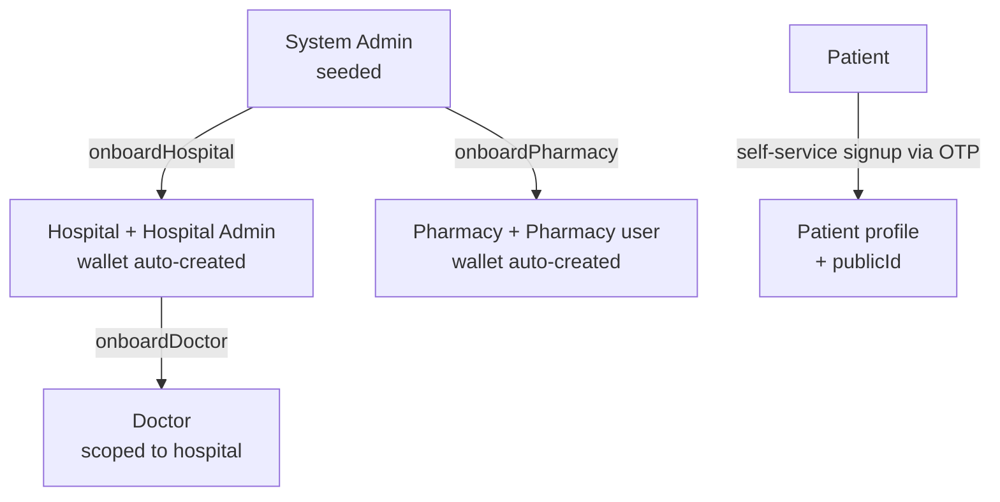
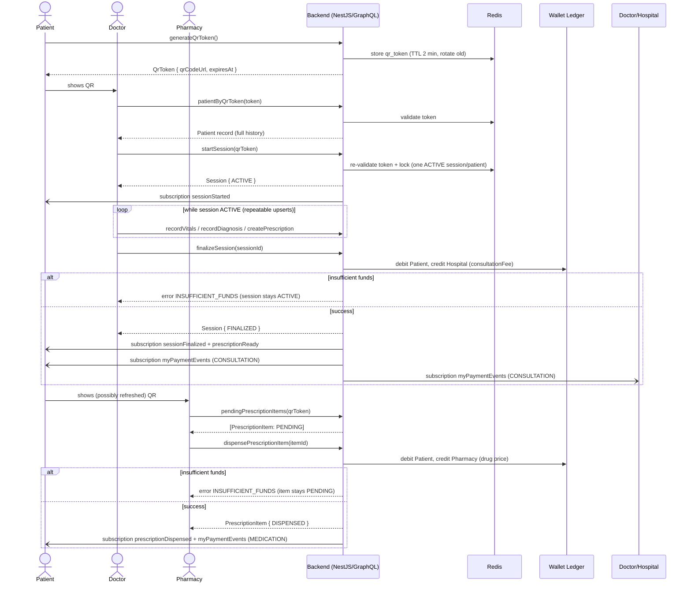

# PRD: Health System Platform (Proof of Concept)

## 1. Overview

A multi-tenant health platform connecting **patients**, **hospitals**, **doctors**, and **pharmacies**. Patients self-onboard and get a shareable, QR-enabled profile URL. Hospitals are onboarded by a system admin; doctors are onboarded by their hospital. Doctors run time-boxed **sessions** with a patient to record vitals, diagnosis, and prescriptions. Pharmacies fulfill finalized prescriptions. Each party (patient, hospital, pharmacy) holds a **wallet** used to pay for consultations and medication.

This PoC prioritizes demonstrating the full flow end-to-end over production hardening (hence OTP stub, mocked wallet provider, etc.).

## 2. Goals / Non-Goals

**Goals**
- Demonstrate the full patient journey: onboard → QR issued → hospital visit → session → diagnosis/prescription → payment → pharmacy fulfillment → payment.
- Demonstrate role-based onboarding hierarchy: Admin → Hospital → Doctor.
- Demonstrate real-time notifications across roles.
- Demonstrate wallet-based payments via a mocked payment provider interface (swappable for Devdraft later).

**Non-Goals (for PoC)**
- Real OTP delivery (SMS/email).
- Real money movement / regulatory compliance (KYC, PCI, etc.).
- Insurance/claims handling.
- Multi-pharmacy routing/logistics, inventory management.
- Mobile apps (API + socket contract only; any UI is out of scope unless separately specced).

## 3. Actors & Roles

| Role | Onboarded by | Key capabilities |
|---|---|---|
| **System Admin** | Seeded/bootstrap | Onboard hospitals, onboard pharmacies, view platform-wide data, manage RBAC roles |
| **Hospital Admin** | System Admin | Onboard/manage doctors at their hospital, view hospital's sessions/revenue, hospital wallet |
| **Doctor** | Hospital Admin | Scan patient QR, start/stop sessions, record vitals/diagnosis/prescriptions |
| **Patient** | Self | View own record, own QR/URL, top up wallet, pay hospital/pharmacy, view history |
| **Pharmacy** | System Admin | Scan patient QR, view finalized/unfulfilled prescriptions, dispense meds, pharmacy wallet |

A user account has exactly one role per actor type for the PoC (no multi-role users).

## 4. Core Domain Concepts

### 4.1 Patient & QR Identity
- On self-onboarding, the patient gets a unique, stable, unguessable internal **publicId** (UUID) — this identifies the patient in the backend/data model but is **never itself encoded in the QR** and is not a durable lookup key for other roles.
- The QR code is **short-lived and dynamic**: the patient's app calls `generateQrToken` to get a `QrToken { token, qrCodeUrl, expiresAt }`, valid for **2 minutes**. The QR encodes `https://<host>/scan/{token}`.
  - Generating a new token immediately invalidates any previously issued token for that patient (rotating — at most one valid token per patient at a time).
  - The patient regenerates on demand (e.g. tapping "Refresh" or reopening the QR screen) — no background auto-polling in the PoC.
  - Tokens are stored in Redis with a TTL matching expiry (`qr_token:{token} → patientId`, plus a reverse pointer `patient_qr_token:{patientId} → token` to support rotation/invalidation) — no DB persistence needed, they're ephemeral by design.
- Any authenticated **doctor** or **pharmacy** user who scans a *currently valid* token gets full read access to that patient's record (history, vitals, diagnoses, prescriptions) — per PoC decision, no per-scan consent step. An expired or already-rotated token fails lookup (`TOKEN_EXPIRED` / `TOKEN_NOT_FOUND`) and the hospital/pharmacy must ask the patient to refresh their QR and re-scan.
- The token is only a *lookup key*, valid at the moment of scanning — it does not itself grant write access. `startSession` re-validates the token is still live at call time; writes thereafter are scoped to the created session (doctor) or to a valid dispense action against a finalized prescription (pharmacy), independent of the token's subsequent expiry.

### 4.2 Session Lifecycle
A **Session** is the unit of clinical work between one doctor and one patient.

States: `ACTIVE → FINALIZED` (terminal). No draft/cancel state in PoC — once started it must be stopped to finalize.

- **Start session**: doctor scans/looks up patient → `POST startSession(patientId)` → creates session in `ACTIVE` state, records `doctorId`, `hospitalId`, `patientId`, `startedAt`.
- **While ACTIVE**: doctor can create/update exactly one of each per session:
  - Vitals record (temp, BP, pulse, weight, etc. — free-form JSON + a few typed fields)
  - Diagnosis (notes, ICD-like free-text code optional)
  - Prescription (one or more line items: drug name, dosage, quantity, instructions)
- Only the doctor who started the session can mutate it while active. Only one ACTIVE session per patient at a time (enforce uniqueness) — prevents concurrent conflicting edits.
- **Stop/finalize session**: `POST finalizeSession(sessionId)` → sets `FINALIZED`, `finalizedAt`. Once finalized, vitals/diagnosis/prescription become immutable.
- Prescriptions only become visible/actionable to pharmacies **after** finalization. A pharmacy cannot see prescriptions from an ACTIVE (unfinalized) session.
- Consultation fee is charged to the patient wallet → hospital wallet on finalization (see §4.4).

### 4.3 Prescription Fulfillment
- After finalization, prescription line items are in state `PENDING`.
- A pharmacy scans the patient's current QR token (same mechanism as §4.1), sees all `PENDING` prescription items across the patient's finalized sessions.
- Pharmacy marks item(s) `DISPENSED` (partial dispense of a multi-item prescription allowed — each line item has its own status).
- Dispensing a line item triggers a wallet charge: patient → pharmacy wallet. The pharmacy sets the price for that drug (pharmacy maintains its own simple price list/lookup by drug name) at dispense time — the doctor's prescription carries no price, only drug/dosage/quantity/instructions.
- If the patient's wallet balance is insufficient, the dispense action is **blocked** (fails with an error); the pharmacy/patient must top up first and retry.
- No inventory tracking; any pharmacy can dispense any item (first-come basis, no reservation).

### 4.4 Wallets & Payments
- Every Patient, Hospital, and Pharmacy has exactly one wallet, auto-created on onboarding, balance starts at 0.
- **Wallet provider abstraction**: build a `WalletProvider` interface (`credit`, `debit`, `transfer`, `getBalance`) with a `MockWalletProvider` implementation for the PoC (in-memory/Postgres-backed ledger, no external calls). This isolates the future swap to **Devdraft** to a single adapter implementation — no business logic changes needed later.
- **Top-up**: `mutation topUpWallet(amount)` credits the caller's own wallet directly via the mock provider (no real payment rail in PoC).
- **Consultation payment**: triggered automatically on session finalization — debit patient wallet, credit hospital wallet, amount = hospital's flat `consultationFee` (one fee per hospital, not per-doctor). Blocks finalization if patient balance is insufficient.
- **Medication payment**: triggered on each prescription line-item dispense — debit patient wallet, credit pharmacy wallet, amount = pharmacy's price for that drug. Blocks the dispense if patient balance is insufficient.
- All wallet movements recorded as immutable `WalletTransaction` ledger entries (type, amount, from/to wallet, reference to session/prescription item, timestamp) for auditability — no mutation of balances without a corresponding ledger row.

## 5. Functional Requirements by Module

### 5.1 Authentication & OTP
- Signup/login via phone or email + OTP (no password for PoC).
- OTP is **hardcoded `000000`** for every request in this environment — the send-OTP endpoint logs/returns it is accepted but doesn't actually dispatch SMS/email. Clearly flag this as demo-only (e.g. a `DEMO_MODE` env flag so it's obvious this must change before any real deployment).
- JWT access + refresh token issuance on successful OTP verification.

### 5.2 RBAC
- Roles: `SYSTEM_ADMIN`, `HOSPITAL_ADMIN`, `DOCTOR`, `PATIENT`, `PHARMACY`.
- Enforced via NestJS guards + GraphQL field/resolver-level decorators (e.g. `@Roles(Role.DOCTOR)`).
- Resource-level checks beyond role (e.g. "doctor belongs to the hospital that owns this session", "only this patient can top up their own wallet") must be enforced in resolvers/services, not just role gates.

### 5.3 Onboarding
- **System Admin**: seeded (e.g. via migration/seed script) — no self-signup for admin in PoC.
- **Hospital onboarding**: Admin creates hospital (name, address, consultationFee) + its initial Hospital Admin user by directly supplying that admin's email/phone. Hospital wallet auto-created. The new Hospital Admin logs in on their own device via OTP (`000000`) using the email/phone the system admin entered.
- **Pharmacy onboarding**: Admin creates pharmacy (name, address) + initial Pharmacy user (email/phone supplied directly by admin). Pharmacy wallet auto-created.
- **Doctor onboarding**: Hospital Admin creates doctor user scoped to their hospital, supplying the doctor's email/phone directly. Doctor logs in via OTP on their own device.
- No invite-link flow in PoC — the onboarder always types the new user's login identifier directly; the account exists immediately and is usable as soon as the invitee runs OTP login with it.
- **Patient onboarding**: self-service signup (OTP) → profile creation → stable internal `publicId` assigned; QR token is generated on-demand afterward (not at onboarding time, since it's short-lived).

### 5.4 Patient Record
- Patient profile: name, DOB, sex, contact, blood type (optional), allergies (optional free text) — kept minimal for PoC.
- Patient record aggregates: list of sessions (with vitals/diagnosis/prescriptions), wallet balance/history.
- `patientByQrToken(token)` — used by doctor/pharmacy QR scan flow (RBAC: DOCTOR or PHARMACY role only); resolves the scanned short-lived token (Redis-backed, see §4.1) to a patient, erroring if expired/invalid.

### 5.5 Real-time Notifications (GraphQL Subscriptions)
Single transport: **GraphQL subscriptions** over WS (`graphql-ws`), backed by Redis pub/sub for multi-instance fan-out. No separate Socket.IO gateway — frontend only needs one GraphQL client (queries, mutations, and subscriptions all through the same schema).

Events (per earlier decisions — session lifecycle, payments, prescription-ready, onboarding approvals):
| Event | Recipient(s) | Payload |
|---|---|---|
| `session.started` | Patient | sessionId, doctorName, hospitalName, startedAt |
| `session.finalized` | Patient | sessionId, finalizedAt, feeCharged |
| `prescription.ready` | Patient | sessionId, prescription items |
| `prescription.dispensed` | Patient | itemId, pharmacyName, amountCharged |
| `payment.succeeded` | Payer + Payee | walletTxId, amount, type (consultation/medication/topup) |
| `payment.failed` | Payer | reason (e.g. insufficient funds) |
| `onboarding.hospitalCreated` | New Hospital Admin | hospitalId, credentials/next-steps |
| `onboarding.doctorCreated` | New Doctor | doctorId, hospitalName |

- Clients authenticate the socket connection with the same JWT used for GraphQL.
- Redis used as: the pub/sub backbone for horizontal scaling of subscriptions, the store for short-lived/rotating QR tokens (§4.1, TTL 2 min), and session locks to enforce "one active session per patient".

## 6. Data Model (high-level, Prisma/Postgres)

Key entities (fields illustrative, not exhaustive):

- `User` (id, role, email/phone, name, hospitalId?, pharmacyId?, createdAt)
- `Patient` (id, userId, publicId [unique, indexed], dob, sex, allergies, ...)
- `Hospital` (id, name, address, consultationFee, walletId)
- `Pharmacy` (id, name, address, walletId)
- `Doctor` (id, userId, hospitalId)
- `Session` (id, patientId, doctorId, hospitalId, status[ACTIVE|FINALIZED], startedAt, finalizedAt)
- `Vitals` (id, sessionId [unique], data JSON, recordedAt)
- `Diagnosis` (id, sessionId [unique], notes, code?, recordedAt)
- `Prescription` (id, sessionId [unique], createdAt)
- `PrescriptionItem` (id, prescriptionId, drugName, dosage, quantity, instructions, status[PENDING|DISPENSED], dispensedByPharmacyId?, dispensedAt?, pricedAt?)
- `PharmacyDrugPrice` (id, pharmacyId, drugName, price) — pharmacy's own simple price list, looked up by drug name at dispense time
- `Wallet` (id, ownerType[PATIENT|HOSPITAL|PHARMACY], ownerId, balance)
- `WalletTransaction` (id, walletId, type[TOPUP|CONSULTATION|MEDICATION|TRANSFER], amount, direction[CREDIT|DEBIT], counterpartyWalletId?, referenceType, referenceId, createdAt)

Constraints worth encoding at the DB level: one ACTIVE session per patient (partial unique index on `patientId` where `status = ACTIVE`), one wallet per owner, unique `publicId` on `Patient`.

## 7. Tech Stack (confirmed)

- **Backend framework**: NestJS
- **API**: GraphQL (code-first with `@nestjs/graphql`, or schema-first — recommend code-first for PoC speed)
- **DB**: PostgreSQL via Prisma
- **Cache / pub-sub**: Redis (session locks, socket fan-out)
- **Realtime**: GraphQL subscriptions over WS (`graphql-ws`) or Socket.IO gateway — pick one consistently (recommend GraphQL subscriptions to keep a single API surface)
- **Auth**: JWT (access + refresh), OTP stub (`000000`)
- **Payments**: `WalletProvider` interface, `MockWalletProvider` now, Devdraft adapter later

## 8. Out of Scope for PoC (explicitly)
- Real payment settlement / Devdraft integration (interface only, mocked impl)
- Patient consent-gating on QR scans
- Pharmacy inventory/stock levels
- Multi-role users, hospital-to-hospital transfer of patients
- Audit/compliance logging beyond the wallet ledger
- Rate limiting, advanced fraud detection

## 9. Decisions (resolved)

1. **Pricing**: Consultation fee is flat per hospital (`Hospital.consultationFee`). Medication price is set by the pharmacy per drug (`PharmacyDrugPrice`), looked up at dispense time — the doctor's prescription never carries a price.
2. **Insufficient funds**: Both `finalizeSession` and `dispenseItem` **block** (return an error, no state change) if the patient's wallet balance is insufficient. Patient must top up and retry.
3. **Realtime transport**: GraphQL subscriptions only (no separate Socket.IO gateway), backed by Redis pub/sub.
4. **Onboarding credentials**: The onboarder (System Admin or Hospital Admin) types the new user's email/phone directly when creating the account. No invite-link step — the account is immediately usable via OTP login.

## 10. Suggested Milestones (PoC build order)
1. Auth (OTP stub, JWT) + RBAC scaffolding + Prisma schema + seed script (system admin)
2. Onboarding chain: Admin→Hospital(+Admin), Hospital→Doctor, Admin→Pharmacy, self-serve Patient signup + QR generation
3. Wallet module + MockWalletProvider + top-up
4. Session lifecycle (start/stop) + vitals/diagnosis/prescription CRUD scoped to active session
5. Consultation payment on finalize + prescription visibility to pharmacy
6. Pharmacy dispense flow + medication payment
7. Realtime notifications (Redis pub/sub + subscriptions/socket gateway) wired into steps 4–6
8. End-to-end demo script / Postman-or-GraphQL-Playground walkthrough

## 11. Process Flow Diagrams

### 11.1 Onboarding hierarchy

### 11.2 End-to-end patient visit (consultation → prescription → pharmacy)

### 11.3 Session state machine

```mermaid
stateDiagram-v2
    [*] --> ACTIVE: startSession(qrToken)\n(doctor, valid token, no other ACTIVE session for patient)
    ACTIVE --> ACTIVE: recordVitals / recordDiagnosis / createPrescription\n(repeatable upserts)
    ACTIVE --> FINALIZED: finalizeSession\n(blocks if patient balance < consultationFee)
    FINALIZED --> [*]: prescription items become PENDING\nfor pharmacy pickup; all fields immutable
```

